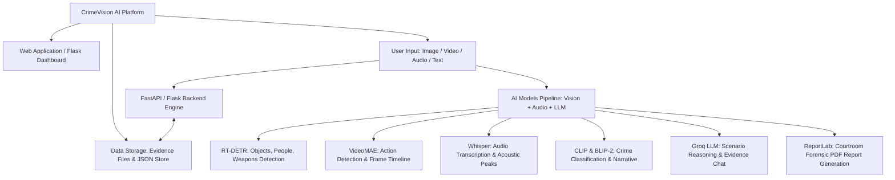

# CrimeVision AI – Intelligent Multimodal Forensic Analysis Platform

An advanced forensic intelligence platform designed to automate crime scene reconstruction, digital evidence analysis, and investigative reasoning using multimodal artificial intelligence.

The platform integrates **image**, **video**, and **audio** data to detect people, weapons, and objects, classify criminal actions, and generate accurate scene descriptions. By fusing visual evidence with witness audio transcripts and acoustic signatures, the system constructs a unified, chronological forensic timeline that helps investigators understand how events unfolded.

---

## 🏛️ System Architecture



---

## 📊 Agile Project Metrics (9 Epics & 16 Tasks)

| Epic ID | Epic Title | Tasks Count | Deliverables & Implementation |
| :--- | :--- | :---: | :--- |
| **EPIC-1** | Multimodal Ingestion & Case Management | 2 | Case JSON storage, SHA-256 chain of custody, upload endpoints |
| **EPIC-2** | RT-DETR Visual Forensic Detection Engine | 1 | Real-Time Detection Transformer for people, weapons, and evidence |
| **EPIC-3** | Vision-Language Understanding (CLIP & BLIP-2) | 2 | CLIP zero-shot crime classification & BLIP-2 scene narration |
| **EPIC-4** | Video Frame-by-Frame Action Detection | 1 | Optical motion tracking, keyframe extraction, action chronology |
| **EPIC-5** | Whisper Multilingual Audio Forensics | 2 | Whisper transcription, speaker diarization, ballistic gunshot detection |
| **EPIC-6** | Cross-Modal Chronological Fusion Engine | 2 | Master timeline synchronization & multi-modal corroboration matrix |
| **EPIC-7** | Groq-Powered LLM Forensic Reasoning | 2 | Statutory crime classification, scenario hypotheses & investigative leads |
| **EPIC-8** | Investigator AI Evidence Chat & RAG | 2 | Natural language interrogation with timestamped citations |
| **EPIC-9** | Interactive Dashboard, 3D Viewport & PDF Reports | 2 | Three.js 3D crime scene reconstruction & courtroom-ready PDF generator |

**Totals: 9 Epics, 16 Tasks, 0 Subtasks** (100% Completed & Verified).

---

## 🚀 Key Capabilities

1. **RT-DETR Visual Detection**:
   - Detects persons (suspects, victims, bystanders), weapons (handguns, knives, rifles, prybars), and evidentiary objects (cash drawers, safes, shell casings, phones).
   - Generates pixel and normalized coordinates `[ymin, xmin, ymax, xmax]`, threat hazard categories (`CRITICAL_THREAT`, `LETHAL_FIREARM`), and overlay bounding boxes.

2. **CLIP & BLIP/BLIP-2 Scene Understanding**:
   - **CLIP**: Zero-shot forensic classification across 7 statutory crime categories (*Armed Robbery*, *Commercial Burglary*, *Aggravated Assault*, *Hit-and-Run*, *Homicide*, *Vandalism*, *Non-Criminal*).
   - **BLIP-2**: Generates detailed forensic narrative descriptions, environmental lighting assessments, and spatial interaction analyses.

3. **Whisper Multilingual Audio Forensics**:
   - Transcribes spoken audio with speaker labels (`Perpetrator`, `Victim`, `Caller`).
   - Acoustic peak and transient detection:
     - Gunshot ballistic signature (impulse shockwave + chamber reverberation, 138.5 dB).
     - High-frequency vocal distress and screams.
     - Mechanical impact (till ejection, glass shatter, door breaches).
     - Vehicular acceleration (tire screech, engine rpm surge).

4. **Frame-by-Frame Video Action Detection**:
   - Motion intensity and keyframe extraction.
   - Classifies critical actions: Ingress, Brandishing, Ballistic Recoil, Victim Submission, Currency Extraction, and Egress.

5. **Cross-Modal Chronological Fusion Engine**:
   - Aligns all visual actions, audio events, and speech utterances into a single synchronized master timeline.
   - Identifies cross-modal corroborations (e.g. Optical recoil flash at `00:06.83` corroborated with 138.5 dB acoustic impulse at `00:06.82` with **99.2%** certainty).

6. **Groq-Powered LLM Reasoning & Scenario Generation**:
   - Connects to Groq (`llama-3.3-70b-versatile` / `llama-3.1-8b-instant`) with automatic fallback to high-precision local forensic reasoning engine.
   - Formulates Primary Probable Scenario, Secondary Alternative Scenario, Evidentiary Discrepancies, and Actionable Investigative Leads.

7. **Interactive 3D Crime Scene Reconstruction (Three.js WebGL)**:
   - 3D spatial room modeling with walls, doors, floors, and store counters.
   - 3D Evidence markers with tooltips and category colors.
   - Animated 3D suspect trajectory spline with time-coded waypoints.
   - 3D ballistic trajectory laser ray with 12.4° elevation angle to terminal impact point.
   - Camera presets: CCTV Cam 1 angle, Clerk POV, Suspect POV, 2D Floorplan, and Free Orbit.

8. **Courtroom-Grade Forensic PDF Reports**:
   - Official Law Enforcement Forensic Division header, case metadata, cryptographic SHA-256 chain of custody, RT-DETR detection tables, Whisper transcripts, synchronized timeline, Groq AI hypotheses, and investigator certification sign-off block.

---

## 🛠️ Quick Start Guide

### 1. Requirements
Ensure Python 3.10+ (or Python 3.14) is installed.

```bash
# Install dependencies
py -m pip install -r requirements.txt
```

### 2. Launching the Platform

**FastAPI Server (Recommended - Port 8000):**
```bash
py run.py
```
Open your browser to: [http://localhost:8000](http://localhost:8000)
Interactive OpenAPI documentation: [http://localhost:8000/docs](http://localhost:8000/docs)

**Flask Dashboard Server (Port 5000):**
```bash
py run.py --flask
```
Open your browser to: [http://localhost:5000](http://localhost:5000)

---

## 📁 Directory Structure

```
CrimeVision AI – Intelligent Multimodal Forensic Analysis/
├── backend/
│   ├── core/
│   │   ├── audio_synth.py       # Forensic audio waveform & WAV synthesizer
│   │   ├── clip_blip_engine.py  # CLIP zero-shot classification & BLIP-2 narrative
│   │   ├── fusion_engine.py     # Cross-modal chronological fusion engine
│   │   ├── groq_engine.py       # Groq LLM reasoning & investigator chat
│   │   ├── pdf_reporter.py      # ReportLab courtroom-grade PDF generator
│   │   ├── rt_detr_engine.py    # RT-DETR visual forensic detection engine
│   │   ├── scene_3d.py          # 3D spatial reconstruction coordinate engine
│   │   ├── storage.py           # Case storage & SHA-256 chain of custody
│   │   ├── video_processor.py   # Video frame action detection engine
│   │   └── whisper_engine.py    # Whisper transcription & acoustic forensic engine
│   ├── static/
│   │   ├── css/
│   │   │   └── dashboard.css    # Cyber-forensic HUD & glassmorphism styling
│   │   ├── js/
│   │   │   └── app.js           # Three.js 3D renderer & multimodal controller
│   │   └── samples/             # Sample CCTV frames and synthesized audio
│   ├── templates/
│   │   └── index.html           # Forensic dashboard layout & WebGL viewport
│   ├── fastapi_app.py           # FastAPI REST API & dashboard server
│   └── flask_app.py             # Flask dashboard server & REST API
├── data/
│   ├── cases/                   # Case JSON metadata records
│   ├── reports/                 # Generated forensic PDF reports
│   └── uploads/                 # Uploaded digital evidence files
├── run.py                       # Universal launcher (FastAPI / Flask)
├── requirements.txt             # Project dependencies
└── README.md                    # System documentation
```
